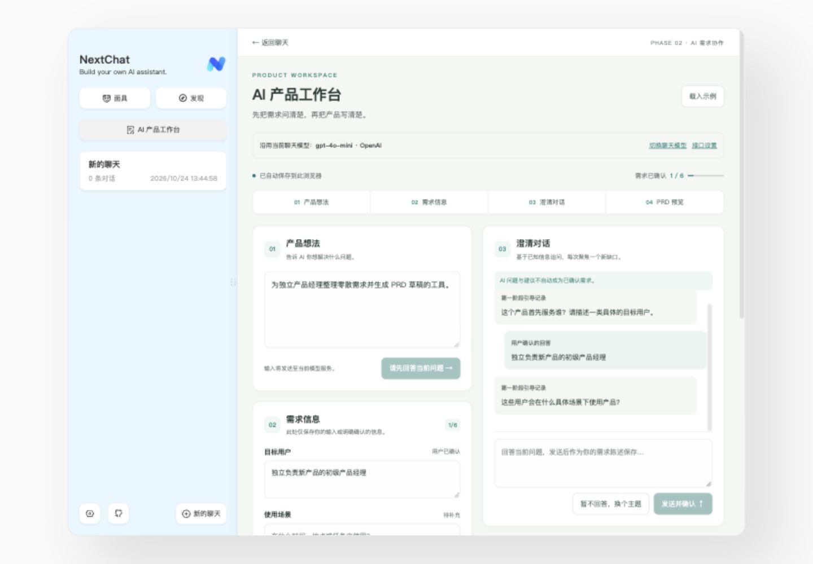
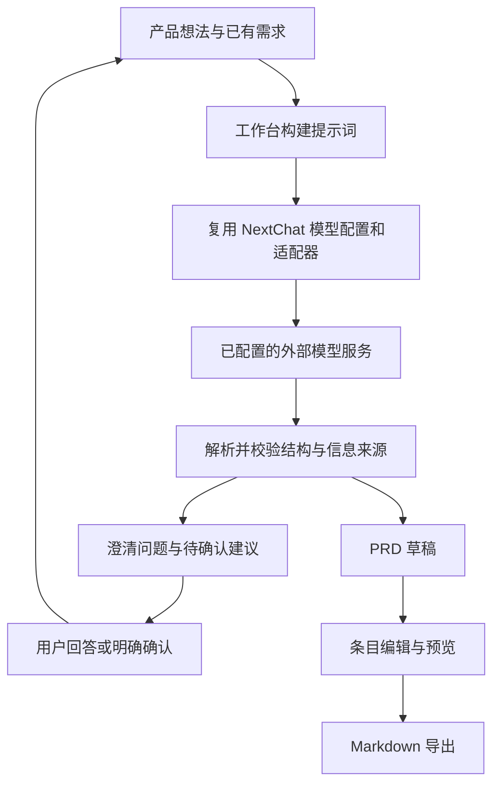

# AI 产品工作台｜基于 NextChat 的需求澄清与 PRD 学习作品

> 面向模糊需求梳理场景的 AI 产品经理求职作品：将产品想法、澄清对话、用户确认与 PRD 草稿连接起来。
>
> 本项目基于 [NextChat 开源项目](https://github.com/ChatGPTNextWeb/NextChat) 学习和二次开发。聊天、模型接入等基础能力来自上游；本次作品的重点是新增的「AI 产品工作台」。这是借助 AI 编程助手完成的产品实践，不是从零独立开发的聊天平台。

**当前状态：本地网页原型；真实模型澄清已验证，PRD 完整真实调用流程仍待补充验证。**

## 产品界面



*截图取自 2026-10-24 的本地工作台，展示演示需求与页面布局。图中模型选择为当时配置，不是固定默认模型；截图不代表真实 PRD 全流程已验证。*

## 项目背景与定位

“想做一个 AI 工具”通常还不足以进入开发：目标用户不明确、使用场景缺失、首版范围过大，或将模型推测直接写成需求事实。

本作品尝试把通用聊天工具改造成一个有流程约束的需求工作台：先收集信息，再针对缺口提问，由用户确认后整理为可评审的 PRD 草稿。

- **面向人群**：需要独立梳理早期需求的初级产品经理、产品学习者。
- **使用场景**：接到模糊产品想法，准备首次需求讨论或评审资料。
- **设计目标**：让需求依据、AI 建议和待确认事项更容易区分。
- **产品边界**：辅助整理需求，不能替代用户调研、需求决策或正式评审。上述定位是设计假设，目前没有真实用户研究或量化提效数据支撑。

## 上游能力与本次实际贡献

| 范围 | 来源与说明 |
| --- | --- |
| 普通聊天、会话管理、模型与接口设置 | 复用 NextChat 原有实现，未作为个人原创能力展示 |
| 多服务商适配、模型请求及认证基础设施 | 来自上游；工作台调用其现有客户端，不自建模型服务 |
| Markdown 展示、主题、多语言、面具等基础能力 | 上游已有能力；不代表本次逐项进行了实测 |
| 工作台导航与四区页面 | 本次新增：产品想法、需求信息、澄清对话、PRD 预览 |
| 需求澄清与信息确认流程 | 本次新增：已知信息与已问主题控制、建议采纳／不采纳、明确确认及撤销 |
| PRD 数据结构与审阅交互 | 本次新增：七章结构、来源快照、条目编辑、预览与 Markdown 导出 |
| 草稿与异常体验 | 本次新增：独立本地草稿、旧草稿恢复、加载／取消／错误／重试状态 |
| 工作台 OpenAI 兼容接口路径处理 | 本次修复：避免 OpenRouter 地址产生重复 `/v1`；不改全局接口配置和普通聊天适配器 |
| 工作台相关自动化测试 | 本次新增：数据规则、API 回调、页面交互与路径隔离测试 |

本次实践以 AI 产品经理视角完成场景选择、流程与信息状态设计，并在 AI 编程助手协助下落实界面、调用逻辑、测试和问题排查。底层模型、训练能力、通用聊天框架和全部上游功能均不属于本次个人开发贡献。

## 已实现功能与验证范围

| 功能 | 当前行为 | 验证情况 |
| --- | --- | --- |
| 产品想法与需求录入 | 支持目标用户、使用场景、核心痛点、成功标准、首版范围、限制与边界六项信息 | 页面检查、自动化测试 |
| AI 分步澄清 | 根据已有信息提出一个新问题；过滤已明确／已问主题，拦截相同问题文本 | 自动化测试；OpenRouter／DeepSeek 真实澄清调用成功 |
| 区分陈述与推测 | 用户输入或明确采纳的信息进入确认来源；AI 推测保持待确认，可不采纳或撤销确认 | 自动化测试；真实页面展示已验证 |
| 结构化 PRD | 校验七章结构、条目状态与来源；不符合结构的响应不会覆盖原文档 | 已实现，模拟模型响应的自动化测试通过；真实模型完整生成流程待验证 |
| 编辑、预览与导出 | PRD 条目可编辑；修改后重新确认；支持预览与 Markdown 导出 | 自动化交互测试通过；真实模型生成后的完整人工操作流程待验证 |
| 本地草稿与旧数据恢复 | 使用独立存储键保存工作台草稿，恢复早期版本内容；损坏数据不自动覆盖 | 自动化测试；旧草稿恢复有浏览器检查记录 |
| 请求失败处理 | 加载提示、取消、150 秒工作台超时兜底、错误提示与手动重试；失败保留旧草稿 | 自动化测试；HTTP 404 排查及修复后真实重试成功 |

“用户确认”表示用户明确表达或采纳的需求，不等于已通过调研验证的客观事实。去重目前依靠主题和标准化文本规则，尚未实现语义级去重。

### PRD 的七个章节

1. 背景与目标。
2. 目标用户与使用场景。
3. 痛点与需求依据。
4. 功能需求与范围。
5. 核心流程与异常分支。
6. 验收标准。
7. 风险、假设与待确认项。

PRD 使用已确认、AI 建议、待确认等状态区分条目。模型自称“已确认”并不足以成为事实：目前仅在引用文本与确认来源完全一致时保留自动确认状态，否则降为建议，再由用户审阅。这是保守的来源约束，不是完整的事实核查系统。

## 产品设计中的关键取舍

- **先澄清，再写文档**：把需求信息区与对话区并列展示，便于用户检查遗漏，而不是只输出一段长文本。
- **由用户掌握确认权**：AI 推测不会自动变成已确认需求；用户可以采纳、不采纳和撤销。
- **保留修改后的控制权**：编辑条目后需要重新确认；需求改变时提示 PRD 可能过期，不自动重写。
- **优先复用成熟能力**：沿用 NextChat 的模型与认证配置，将本次实现集中在产品流程、数据状态和异常体验。

这些设计展示的是需求分析与原型落地能力，尚不代表商业效果或真实使用效率已经得到验证。

## 技术架构

| 层次 | 实现方式 |
| --- | --- |
| 应用基础 | Next.js 15.5.28、React 19.3.1、TypeScript，沿用上游工程 |
| 导航与界面 | React Router、工作台独立组件、SCSS Modules |
| 模型配置 | 读取 NextChat 的全局配置和当前会话模型配置，复用 Zustand 状态 |
| AI 调用 | 工作台专用客户端工厂 → 上游模型适配器 → 已配置的模型服务；使用非流式文本请求，不继承当前聊天的插件工具执行 |
| 内容处理 | 澄清与 PRD 提示词、JSON 解析、章节／来源／状态校验 |
| 工作台存储 | 浏览器 localStorage，独立键 `nextchat-product-workbench-v1`；不新增业务数据库 |
| 预览与测试 | react-markdown、remark-gfm；Jest、Testing Library |

调用流程：



工作台草稿保存在当前浏览器，但执行 AI 请求时，需求内容会发送至所选模型服务。本地保存不等于内容不出设备；没有为工作台新增账号系统、团队权限或云端草稿同步。

### 主要改造文件

```text
app/components/product-workbench.tsx          工作台页面与交互
app/components/product-workbench.module.scss  工作台样式
app/utils/product-workbench.ts               草稿、来源、PRD 与导出规则
app/utils/product-workbench-ai.ts            提示词、响应解析及请求状态处理
app/client/product-workbench.ts              工作台模型适配与路径兼容
app/components/home.tsx                      接入工作台路由
app/components/sidebar.tsx                   新增工作台入口
app/constant.ts                              新增路由常量
test/product-workbench*.test.ts*             工作台相关测试
```

## 本地运行

### 环境与安装

`package.json` 指定 Yarn **1.22.19**。Next.js 15 要求 Node.js ≥ 18.18；本项目本地开发与测试使用过 Node.js **24.21.0**、npm **11.19.0**，不代表所有 Node.js 版本均已验证。网页开发不要求安装 Docker。

在已具备 Git、Node.js 和 Corepack 的环境中：

```bash
# 当前仓库为私人仓库，需要先具备访问权限
git clone https://github.com/rosemancolandog397-source/NextChat.git
cd NextChat

# 指定项目所用版本，不需要全局安装 Yarn 或执行 corepack enable
corepack yarn@1.22.19 install --frozen-lockfile
corepack yarn@1.22.19 dev
```

默认浏览器地址：`http://localhost:3000/`。

工作台地址：`http://localhost:3000/#/product-workbench`，也可点击侧栏「AI 产品工作台」。以启动日志中的实际端口为准。macOS 如果出现文件监听数量不足，可按需使用 `WATCHPACK_POLLING=1000` 启动开发服务。

### 模型配置

1. 优先通过 NextChat 设置页面配置服务商、接口地址与自己的 API Key，再在普通聊天页选择模型。
2. 返回工作台，检查顶部显示的模型是否符合预期。页面结构与本地模板可先查看，AI 澄清和 AI PRD 请求需要有效的模型权限、额度及网络。
3. OpenRouter 使用 OpenAI 兼容接口配置，模型名称填写服务商提供的完整模型 ID；工作台不硬编码模型名称或密钥。

本版本上游 OpenAI 适配器会追加 `v1/chat/completions`。若希望普通聊天与工作台共用 OpenRouter，可填写基础地址 `https://openrouter.ai/api`。工作台还单独兼容 `https://openrouter.ai/api/v1`，避免重复版本路径；这项修复未扩展到普通聊天代码。

服务端环境变量部署方式及其他服务商说明，请参阅保留的[上游原始 README](./README_UPSTREAM.md)与[上游中文说明](./README_CN.md)。不要将真实密钥、Token、密码或包含认证信息的浏览器存储导出到仓库。

## 验证记录与演示方式

此前代码检查记录（2026-10-25，提交 `cdfe530`）：

- 全项目 **40 个测试套件、212 项测试通过**，包含上游和其他已有测试，不能全部算作工作台新增测试。
- TypeScript 检查及当次选定文件的 ESLint 检查通过。
- OpenRouter／DeepSeek 真实澄清请求成功，页面展示新问题及独立待确认建议。
- PRD 结构解析、编辑、预览、导出、取消与错误处理由模拟接口测试覆盖；此前一次真实 PRD 返回不完整结构，页面保留旧草稿。**尚未完成真实模型 PRD 全流程验收**。
- 当时未完成生产构建、线上部署、全服务商兼容或桌面端验收。

本地安全升级验证（2026-10-26）：

- 升级至 Next.js **15.5.28**、React / React DOM **19.3.1**，适配异步路由参数、React 类型及相关依赖。
- **42 个测试套件、238 项测试通过**；类型检查、ESLint 和生产构建通过，仍有非阻断警告。
- 在独立浏览器来源使用生产构建与本机模拟模型，验证聊天、需求澄清、建议确认、PRD 生成、编辑、预览、刷新保存及 Markdown 导出；未调用付费 API，不能据此认定真实服务商全流程已通过。
- 依赖安全复查中 Next.js、React 与 React DOM 未命中适用公告；其他历史依赖仍存在高危公告，需要继续专项治理。
- 线上部署、全服务商兼容及桌面端仍未验收。

可复现的本地检查：

```bash
corepack yarn@1.22.19 test:ci --runInBand
corepack yarn@1.22.19 tsc --noEmit --incremental false
```

建议评审按以下顺序查看作品：

1. 输入一个演示产品想法，补充部分需求，观察工作台如何提问。
2. 区分用户陈述与 AI 推测，尝试采纳、不采纳或撤销确认。
3. 请求生成 PRD，检查七章结构、来源和状态；该步骤仍应作为真实模型验收项目，失败时检查草稿是否保留。
4. 在成功生成 PRD 后，编辑一个条目、重新确认、预览并导出 Markdown，再修改需求，检查过期提示。

## 后续优化方向（规划中）

- 补齐真实模型从澄清到 PRD 生成、编辑、导出的完整验收样例。
- 建立固定需求样例集，评估问题相关性、重复率、来源引用和文档完整度。
- 优化结构化输出的稳定性，改善格式失败时的恢复体验。
- 从主题／文本规则推进到语义级重复问题检测。
- 探索多项目草稿、版本对比和更细粒度的来源追踪。
- 开展小范围用户访谈与可用性测试，验证定位及设计假设。

上述内容未作为已完成功能展示；当前没有团队协作、多项目管理或自动事实核查能力。

## 开源来源、作者与许可证

- 上游项目：[ChatGPTNextWeb / NextChat](https://github.com/ChatGPTNextWeb/NextChat)。原 README 中保留了 `ChatGPT-Next-Web` 等历史名称和链接。
- 原作者及贡献者：[NextChat 上游贡献者](https://github.com/ChatGPTNextWeb/ChatGPT-Next-Web/graphs/contributors)。感谢原作者 Yidadaa、NextChat 团队及社区贡献者。
- 二次开发作品维护账号：[rosemancolandog397-source](https://github.com/rosemancolandog397-source)。
- 开源协议：[MIT License](./LICENSE)，原版权声明 **Copyright (c) 2023-2025 NextChat** 保持不变。
- 完整上游说明：[README_UPSTREAM.md](./README_UPSTREAM.md)；原有中文说明：[README_CN.md](./README_CN.md)。上游文档介绍的企业版、桌面应用、部署方式及宣传数据，不代表本作品自行实现或逐项验证。

本项目最初通过官方 ZIP 获取源码，之后建立本地 Git 仓库，因此当前仓库不包含完整上游 Git 提交历史。保留协议、版权及来源说明，不将二次开发作品包装为全部独立原创。

## Vercel Hobby 部署准备

当前以个人非商业演示为目标，部署说明见 [Vercel Hobby 配置清单](docs/vercel-hobby-deployment.zh-CN.md)。模型调用保留 OpenRouter 与 Upstash Redis 限额保护，密钥仅通过平台环境变量配置。

已关闭 Git 自动部署；提交代码不会自动授权正式上线。尚未完成 Vercel 线上构建和真实 Redis / 模型服务的上线验收。

## Netlify Free 部署

Netlify 部署配置与秘密环境变量清单见 [Netlify 部署说明](docs/netlify-deployment.zh-CN.md)。保留服务端密钥、Redis 限额保护；模型请求最多 50 秒，长生成仍可能超时并保留原有草稿。当前不宣称已完成 Netlify 线上验收。

## 当前公开部署方式：BYOK

公开版本默认用户自带 OpenRouter Key，不提供站长共享额度。复用原设置页的 OpenAI 兼容接口 Key 输入框；服务端固定转发至 OpenRouter，缺少用户 Key 即拒绝。Netlify 不需要站长 API Key 或 Redis Token。详见 [BYOK 配置和安全边界](docs/byok.zh-CN.md)。此前文档中的共享密钥/Redis 预算描述属于历史实现，不能作为当前部署配置。
